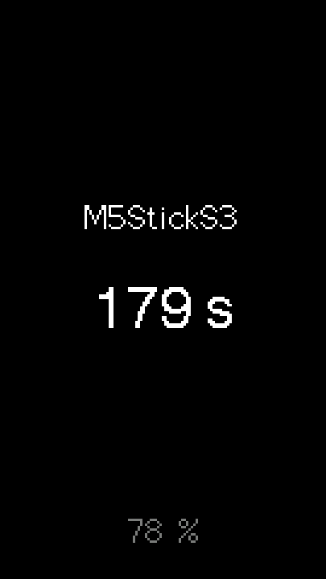

# M5Template

A starting point for [M5StickS3](https://docs.m5stack.com/en/core/StickS3)
firmware with PlatformIO and M5Unified. It builds and runs as is, and it
carries what earlier StickS3 projects found out about the board: build
settings that are easy to get wrong, self-testing over USB, the M5Burner
image, and a reference of hardware quirks.

<p align="center">
  
</p>

The placeholder firmware shows the time since power-on and the battery
level. Your project replaces it.

## What you get

- **Build settings that work.** The board is built as C++17 (the framework
  silently forces C++11 otherwise) with `-O2`, octal PSRAM and the 8 MB
  partitions; the USB port is pinned so PlatformIO never picks the Bluetooth
  one.
- **A firmware skeleton.** The frame is composed in a sprite and pushed at
  once, without flicker, and only when something changed. The screen goes
  dark after 3 minutes without use, wakes on a key press or when the stick is
  picked up, and turns over when the stick is held upside down. A press that
  wakes the screen only wakes it.
- **Logic tested on the computer.** Everything in `lib/` is plain C++ with
  unit tests that run on the Mac in seconds, without the board.
- **Self-testing over USB.** The firmware answers line commands: a
  screenshot, simulated key presses, accelerometer and status lines.
  `tools/serial_cmd.py` sends them and saves screenshots as PNG, without
  resetting the board.
- **A single image for M5Burner** (`-t merged`), with a checklist for
  publishing.
- **Documentation for people and for Claude Code.** `CLAUDE.md` holds the
  rules and commands, `docs/StickS3.md` the board reference.

## Requirements

- An M5StickS3 and a USB-C cable.
- [PlatformIO](https://platformio.org/), installed with the official
  installer. The commands below use its path,
  `~/.platformio/penv/bin/pio`; use plain `pio` if it is on your `PATH`. The
  first build downloads the ESP32-S3 toolchain (several minutes, once per
  machine).
- macOS: port names and the tools assume it. Elsewhere the code builds the
  same, but the port is not `/dev/cu.usbmodem*`.
- Optional: [Claude Code](https://claude.com/claude-code). It reads
  `CLAUDE.md` and can do everything below, including flashing the board and
  checking the result with screenshots.

## Start a new project

```bash
git clone https://github.com/mbogatyr/M5Template.git M5MyProject
cd M5MyProject
rm -rf .git && git init
mv docs/README.template.md README.md
```

Then:

1. Put the project's name in the first line of `platformio.ini` and in
   `README.md`.
2. Rewrite the description at the top of `CLAUDE.md`, replace its
   `Repository:` line and delete its "New project from the template"
   section.
3. Delete the `lib/` modules you don't need, with their `test/test_<module>`
   folders and their lines in `src/main.cpp`.
4. Check that it builds and the tests pass (see below), then make the first
   commit.

With Claude Code it is enough to open the template's folder and ask for a
new project: the steps are in `CLAUDE.md`.

## Everyday commands

```bash
~/.platformio/penv/bin/pio test -e native              # unit tests for lib/ on the computer
~/.platformio/penv/bin/pio run -e sticks3              # build the firmware
~/.platformio/penv/bin/pio run -e sticks3 -t upload    # build and flash over USB
~/.platformio/penv/bin/pio device monitor -e sticks3   # serial log, 115200 baud
```

Self-testing on the board:

```bash
PY=~/.platformio/penv/bin/python
$PY tools/serial_cmd.py snap screen.png    # screenshot, scaled up 3x
$PY tools/serial_cmd.py send st            # status: board, display, battery, free RAM
$PY tools/serial_cmd.py send k1            # press KEY1 (k2 for KEY2)
$PY tools/serial_cmd.py send acc --wait 3  # accelerometer lines (send again to stop)
$PY tools/serial_cmd.py monitor 10         # print what the board says
```

Only one program can hold the port: stop `pio device monitor` before
flashing or running `serial_cmd.py`. Add your own commands to `runCommand()`
in `src/main.cpp`.

## Where code goes

| Path | What goes there |
|---|---|
| `lib/` | The logic: plain C++ with no Arduino, no M5Unified, no hardware. It gets the current time and the inputs as arguments, so tests can run it at any moment without waiting. One folder per module. |
| `test/test_<module>/` | Unit tests for that module (Unity), run on the computer. |
| `src/main.cpp` | Wiring: reads the buttons, the IMU and the battery, feeds `lib/`, handles serial commands. |
| `src/Renderer.*` | Drawing. Put everything the screen shows in `Renderer::Screen` and draw it in `paint()`. |
| `tools/` | Scripts for the computer. |
| `docs/` | Screenshots, the board reference, the M5Burner record. |

Keep hardware out of `lib/`: the native tests build only `lib/`, and an
Arduino include there breaks them.

The modules that come with the template:

| Module | What it does |
|---|---|
| `DisplayTimeout` | Turns the screen off after 3 minutes without activity; the application decides what counts as activity |
| `Orientation` | Decides from the accelerometer whether the stick is upside down, in portrait or landscape |
| `PickupDetector` | Notices the stick being picked up while the screen is off, but not a stick lying still at any angle |
| `BatteryFilter` | Keeps the battery percentage steady: the reading sags under load |

The screen is portrait (135 x 240, KEY1 below the screen). For landscape,
change the rotations in `src/Renderer.cpp` to 1 and 3 and use
`Orientation::Layout::Landscape`.

## Publishing to M5Burner

```bash
~/.platformio/penv/bin/pio run -e sticks3 -t merged
```

This builds `.pio/build/sticks3/firmware-merged.bin`: the bootloader, the
partition table and the application in one image, written at address 0x0,
which is what M5Burner expects. A bare `firmware.bin` would overwrite the
bootloader there. [docs/m5burner.md](docs/m5burner.md) has the steps: the
files to prepare, the cover, how to check the image on the board, the
upload form and how the site behaves. Fill in its table when you publish.

## When something goes wrong

| Symptom | What to do |
|---|---|
| The upload fails with "No serial data received" | Hold the side button until the internal green LED blinks (download mode) and upload again. |
| The screen stays dark after such an upload | Press the side button once: the chip stayed in the bootloader. |
| No `/dev/cu.usbmodem*` port at all | The board is off. Press the side button once. |
| The firmware stopped, the log shows `waiting for download` | A script opened the port and reset the chip into the bootloader. Press the side button once, and open the port with `serial_cmd.py`. |
| Nothing arrives on Serial | `Serial.begin(115200)` is missing from `setup()`. |
| Code passes the tests but does not compile for the board | Check that `platformio.ini` still has `build_unflags = -std=gnu++11`. |

The side button belongs to the power chip, not the firmware: press to power
on or reset, double press to power off, hold for download mode.

## Documentation

- [CLAUDE.md](CLAUDE.md): the rules of the project, commands, build settings
  and why they are there, the serial protocol, how to flash and test.
- [docs/StickS3.md](docs/StickS3.md): the board reference: buttons, IMU,
  memory and speed, drawing, microphone and speaker, power, storage, Wi-Fi
  and Bluetooth, tools on the Mac, and links to projects with working code.
- [docs/m5burner.md](docs/m5burner.md): publishing on M5Burner.
- [docs/README.template.md](docs/README.template.md): the README for your
  project.

## License

[MIT](LICENSE)
